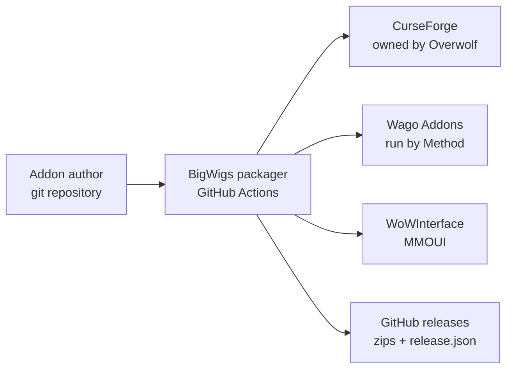
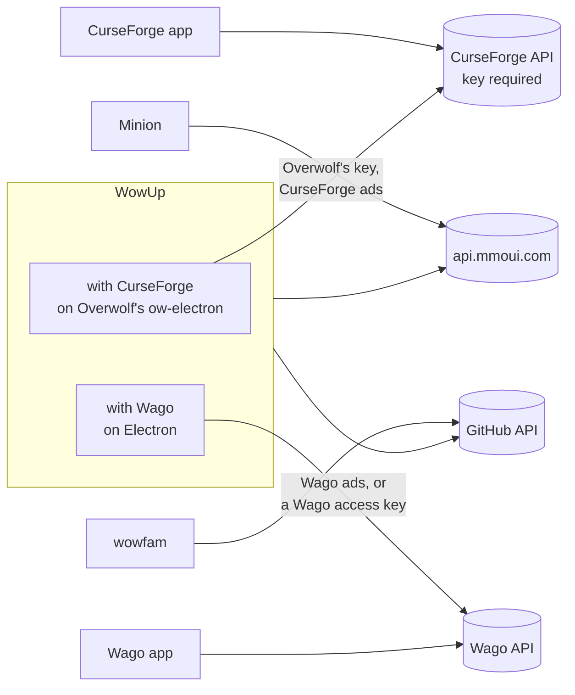
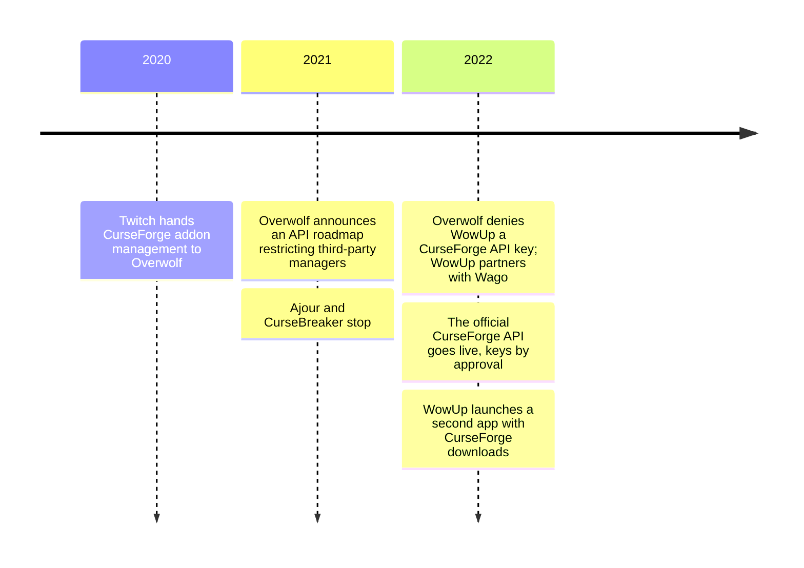
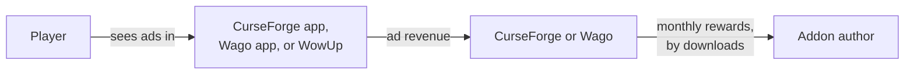

# Where WoW addons come from

A one-page map of the addon sites, the apps that install from them, and the money and API access
that hold it together, as of November 2026. It explains why wowfam installs from GitHub releases
and nothing else, and what the other options would cost. Sources are linked inline and listed at
the end.

## The four sources

Most addon authors write their code once and publish the same zip to several places. The
[BigWigs packager](https://github.com/BigWigsMods/packager), run from GitHub Actions, builds the
zips and "can also upload them to CurseForge, WoWInterface, Wago, and GitHub (as a release)". It
also attaches a `release.json` saying which zip is for which game, which is what wowfam reads.

| Source | Who runs it | How a third-party app gets addons from it |
|---|---|---|
| [CurseForge](https://www.curseforge.com/wow) | Overwolf | The CurseForge API, only with an API key Overwolf approves; each author can also block third-party apps for a project |
| [Wago Addons](https://addons.wago.io) | Method | The Wago API, through an agreement: WowUp has one, and it requires ads |
| [WoWInterface](https://www.wowinterface.com) | MMOUI | Its API (`api.mmoui.com`), which WowUp calls |
| GitHub releases | the author | GitHub's public REST API; anyone can read it |

## The apps

Each site has an app of its own, and [WowUp](https://wowup.io) is the open-source app that tries
to install from all of them.

- **CurseForge app** (Overwolf): installs from CurseForge. It first ran inside Overwolf; a
  standalone build followed in 2022, with a
  [Linux alpha](https://gamingonlinux.com/2022/05/curseforge-modding-client-comes-to-linux-in-alpha-only-supports-wow-for-now)
  that May.
- **Wago app**: Wago's own client for its addons and WeakAuras
  ([listing](https://sourceforge.net/app/wagoapp/)).
- **[Minion](https://minion.mmoui.com)** (MMOUI): WoWInterface's updater, around
  [since 2009](https://www.engadget.com/tag/mmoui-minion).
- **WowUp**: open source (GPL-3.0), free, funded by
  [Patreon](https://www.patreon.com/jliddev). It ships as **two editions built from one
  codebase**, because CurseForge and Wago each set conditions the other's edition can't meet.

### WowUp's two editions

WowUp's [README](https://github.com/WowUp/WowUp#winget) offers "WowUp With Wago"
(`winget install wowup.wowup`) and "Wowup with CurseForge" (`winget install wowup.cf`), and
[wowup.io](https://wowup.io) asks you to "choose your edition". The code shows the split:

- The Wago edition's build
  ([`environment.prod.ts`](https://github.com/WowUp/WowUp/blob/master/wowup-electron/src/environments/environment.prod.ts))
  turns Wago on and CurseForge off.
- The CurseForge edition's build
  ([`environment.prod.ow.ts`](https://github.com/WowUp/WowUp/blob/master/wowup-electron/src/environments/environment.prod.ow.ts))
  turns CurseForge on with an API key injected at build time, turns Wago off, and runs on
  Overwolf's Electron fork, `@overwolf/ow-electron`.
- Both read WoWInterface, GitHub and TukUI.

Both editions show ads, and both say why in the app
([`en.json`](https://github.com/WowUp/WowUp/blob/master/wowup-electron/src/assets/i18n/en.json)):
"In order to use wago.io as an addon provider and help support authors for their hard work on your
favorite addons we are required to show this advertisement", and the same sentence for CurseForge.
The Wago edition hides its ads for anyone with a Wago access key, which comes with
[Wago's Patreon](https://addons.wago.io/patreon).

## How it got this way

- **December 2020**: addon management moved from the Twitch app to Overwolf's CurseForge app
  ([Blizzard forums](https://eu.forums.blizzard.com/en/wow/t/%F0%9F%90%BA-overwolf-addon-management-changeover-now-2nd-december/189111)).
- **November 2021**: Overwolf announced a roadmap to restrict its API to approved third parties
  ([Wowhead](https://www.wowhead.com/news/the-end-of-ajour-overwolf-announces-new-api-roadmap-to-restrict-third-party-324892)).
  The Ajour and CurseBreaker managers stopped
  ([MMO-Champion](https://www.mmo-champion.com/content/10197-Ajour-and-CurseBreaker-Addon-Managers-No-Longer-Maintained)).
- **February 2022**: Overwolf turned down WowUp's application, citing an exclusivity clause, after
  WowUp announced a partnership with Wago
  ([Wowhead](https://www.wowhead.com/news/ads-revenue-and-api-wowup-and-overwolf-split-over-addon-development-325912),
  [Blizzard forums](https://us.forums.blizzard.com/en/wow/t/overwolf-denies-wowup-its-api/1181983)).
  Wago's announcement to authors
  ([Method](https://mailcoach.method.gg/webview/7e52f06b-1a71-4307-aef1-712b3a16a378)) says
  downloads through WowUp are credited to Wago "so that we can compensate developers".
- **2022**: the official CurseForge API went live, with keys by application
  ([Overwolf](https://medium.com/overwolf/the-curseforge-official-api-is-now-live-d314606355c2),
  [MMO-Champion](https://www.mmo-champion.com/content/10587-CurseForge-Official-API-Standalone-Client-Now-Live)).
  Each project got a toggle for third-party distribution, and downloads through third-party apps
  don't count toward the author's rewards
  ([CurseForge support](https://support.curseforge.com/support/solutions/articles/9000207877)).
- **November 2022**: WowUp launched a separate app with CurseForge downloads
  ([Wowhead](https://www.wowhead.com/news=329736/wowup-launches-new-addon-manager-supporting-curseforge-downloads)),
  today's "WowUp with CurseForge".

## Where the money goes

The sites pay authors from ad revenue, so they want downloads to come through something that shows
their ads. That is the condition an addon manager is accepted on.

## What this means for wowfam

wowfam is a command-line tool: it has nowhere to show an ad, and as open source it can't keep an
API key secret. That rules out CurseForge, and Wago's terms as WowUp has them. GitHub releases need
neither, the packager already publishes them for most addons, and its `release.json` says which zip
is for which game. WoWInterface is the one other source whose API WowUp reads without ads; wowfam
doesn't support it yet.

## Sources

- WowUp: [wowup.io](https://wowup.io), [GitHub](https://github.com/WowUp/WowUp),
  [ad texts](https://github.com/WowUp/WowUp/blob/master/wowup-electron/src/assets/i18n/en.json),
  [WoWInterface provider](https://github.com/WowUp/WowUp/blob/master/wowup-lib/src/addon-providers/wow-interface-addon-provider.ts)
- Wowhead:
  [The End of Ajour](https://www.wowhead.com/news/the-end-of-ajour-overwolf-announces-new-api-roadmap-to-restrict-third-party-324892)
  (2021-11-14),
  [WowUp and Overwolf Split](https://www.wowhead.com/news/ads-revenue-and-api-wowup-and-overwolf-split-over-addon-development-325912)
  (2022-02-09),
  [WowUp Launches New Addon Manager Supporting CurseForge Downloads](https://www.wowhead.com/news=329736/wowup-launches-new-addon-manager-supporting-curseforge-downloads)
  (2022-11-05)
- Overwolf:
  [The CurseForge official API is now live](https://medium.com/overwolf/the-curseforge-official-api-is-now-live-d314606355c2),
  [CurseForge support on the third-party toggle](https://support.curseforge.com/support/solutions/articles/9000207877)
- Wago: [Method's announcement of the WowUp partnership](https://mailcoach.method.gg/webview/7e52f06b-1a71-4307-aef1-712b3a16a378),
  [Wago Patreon](https://addons.wago.io/patreon)
- Packaging: [BigWigs packager](https://github.com/BigWigsMods/packager),
  [Using the BigWigs Packager with GitHub Actions](https://warcraft.wiki.gg/wiki/Using_the_BigWigs_Packager_with_GitHub_Actions)
